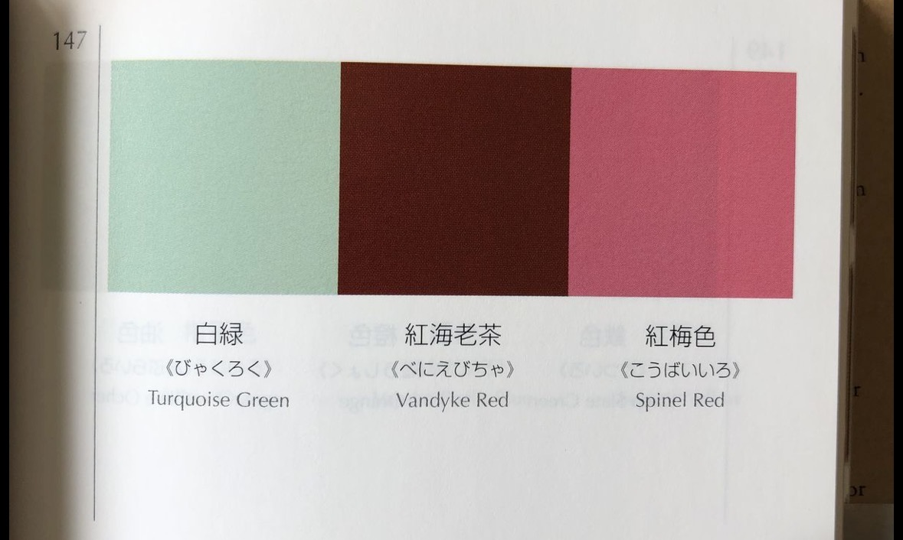

I want to select a class card and then it have an effect of adding it and un-adding it to a list if it is already selected. My current implementation is kind of annoying because I have to check the tickbox but I want to be able to click the card as a whole and it be pressed down. I like the current pressed down looking effect but I want it to look popped up like a button through using shadow and have that as a default before the press down too. You can determine the overall aesthetic yourself. Don't use emojis in my app. Can you also add the color scheme in the picture I attached here to my website and make it aesthetically cohesive? It should overall be airy, sleek, and contemporary in terms of web design.
Color Scheme:
